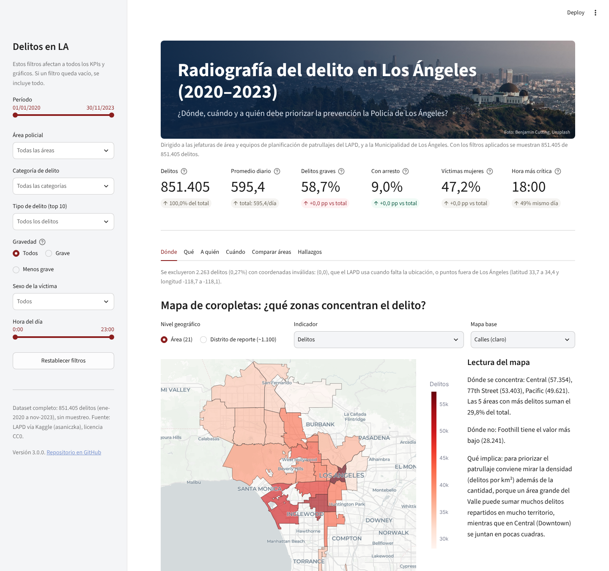

# Radiografía del delito en Los Ángeles (2020–2023)

**Examen final — Dashboard interactivo** · Taller de Visualización de la Información · Universidad del Desarrollo (UDD)

**Integrantes:** Juan Pablo Castillo · Martín Cáceres · Emilio Pacheco

**App en vivo:** https://radiografia-delito-la-mtwjgjtvhro9e56htwhjc2.streamlit.app

**Versión actual:** beta 2.1.0 (Hito 1)



---

## Pregunta y usuario

**¿Dónde, cuándo y a quién debe priorizar la prevención la Policía de Los Ángeles (LAPD)?**

El dashboard está pensado para las **jefaturas de área y los equipos de planificación de patrullajes del LAPD**, y para la **Municipalidad de Los Ángeles**. Convierte en una app interactiva el análisis exploratorio del Certamen 2: el usuario elige qué período, zona, tipo de delito o víctima quiere ver, y todos los KPIs, mapas y gráficos se recalculan.

---

## Qué incluye

**Filtros globales** (panel lateral, afectan a toda la página): período (selector de fechas), área policial, categoría de delito, tipo de delito (top 10), gravedad, sexo de la víctima y hora del día. Si la combinación deja la tabla vacía, la app avisa y se detiene con `st.stop()`. Hay un botón para restablecer los filtros.

**6 KPIs** con `st.metric`: delitos, promedio diario, % de delitos graves, % con arresto, % de víctimas mujeres y hora más crítica. Cada uno compara contra el **total sin filtros** usando `delta`.

| Pestaña | Gráficos (todos con Plotly Express y `st.plotly_chart`) | Controles locales |
|---|---|---|
| 🗺️ **Dónde** | Coropleta por **21 áreas** o **~1.100 distritos** del LAPD (`px.choropleth_map` + GeoJSON) · mapa de puntos (`px.scatter_map`) · mapa de densidad (`px.density_map`) · ranking de áreas | Nivel geográfico, indicador (delitos, por km², % graves, % arresto, variación), mapa base, color de los puntos, cantidad de puntos, tamaño de celda, radio, orden del ranking |
| 🧩 **Qué** | **Sunburst / treemap** (`path` jerárquico + `values`) · 15 delitos más frecuentes · estado del caso por categoría · heatmap lugar × categoría | Tipo de gráfico, jerarquía, variable de color continuo |
| 👥 **A quién** | Histograma de edad · boxplot de edad por delito · sexo de la víctima por delito · **categorías paralelas** (`px.parallel_categories`, color continuo) · **coordenadas paralelas** (`px.parallel_coordinates`, color continuo) | Separar por, agrupar por, dimensiones, variable de color |
| ⏰ **Cuándo** | Línea mensual con hitos de la pandemia · **reloj del delito** (`px.line_polar`, `line_close=True`) · **radar semanal** (`px.line_polar`) · heatmap día × hora · heatmap año × mes · mapa animado por año | Separar la línea por, grupo a comparar, ocultar 12:00, categorías del radar |
| ⚖️ **Comparar áreas** | Comparador A vs B (KPIs, gráfico de mariposa y radar) · relación densidad–arresto de las 21 áreas (burbujas, con tendencia o animado por año) · tasa de arresto por área y categoría | Área A, área B, dimensión, vista |
| 💡 **Hallazgos** | Pregunta, hallazgos escritos, recomendaciones, límites y metodología | — |

Todos los gráficos tienen título, ejes con unidad, la misma paleta de colores (navy, rojo y gris del Certamen 2) y **tooltips personalizados** (`hover_name` / `hover_data` / `labels`). Cada gráfico tiene una caja de **Lectura** con la interpretación, que se recalcula con los filtros. La tabla con los datos filtrados está en un `st.expander` al final de la página.

---

## Datos

| | |
|---|---|
| **Dataset** | *Crime Data from 2020 to Present* — LAPD, publicado en Kaggle por asaniczka: https://www.kaggle.com/datasets/asaniczka/crimes-in-los-angeles-2020-2023 (CC0) |
| **Archivo en el repo** | `data/delitos_LA_limpio.csv.gz` — **dataset limpio del Certamen 2, completo** |
| **Tamaño** | 851.405 filas × 13 columnas, **19 MB** comprimido |
| **Período** | 01-01-2020 al 30-11-2023 (diciembre de 2023 se cortó porque tiene solo 4 días) |

**No se usa muestra para los KPIs ni para los agregados:** el CSV limpio pesa 19 MB comprimido en `.gz`, bajo el límite de 25 MB de la pauta, y `pd.read_csv` lo lee directo. Solo los gráficos que dibujan **cada fila** usan una muestra reproducible con `random_state=42`, para que el navegador no se ponga lento:

| Gráfico | Muestra |
|---|---|
| Mapa de puntos | 10.000 por defecto (el usuario puede subir a 100.000) |
| Boxplot de edad | 30.000 víctimas (las medianas se calculan con todos los datos) |
| Categorías paralelas | 20.000 víctimas |
| Coordenadas paralelas | 5.000 víctimas |

**Limpieza (la misma del Certamen 2, script `preparar_datos.py`):** fechas a `datetime`; arma vacía → "Sin arma"; sexo H y "-" → X y vacío → "Sin dato"; lugar vacío → "Sin dato"; retraso de la denuncia en días. La edad 0 o negativa se excluye solo en los gráficos de edad. Las coordenadas inválidas (0,0) se excluyen solo de los mapas y la app informa cuántas son (2.263, el 0,27%).

**GeoJSON** (`data/`): límites de las **21 áreas** (`lapd_areas.geojson`, con su superficie en km²) y de **~1.135 distritos de reporte** (`lapd_distritos.geojson`) del LAPD, del proyecto *Mapping L.A.* del Los Angeles Times (https://github.com/datadesk/boundaries.latimes.com), que los tomó del LAPD. Control de calidad: el 98,7% de los delitos cae dentro del polígono de su área y el 99,8% tiene su distrito en el mapa.

**Categorías:** las 138 descripciones de delito del LAPD se agrupan en 7 categorías en español (Violencia y amenazas, Vehículos, Robos y hurtos, Vandalismo, Fraude e identidad, Delitos sexuales y Otros) con reglas de texto que están en el código.

---

## Estructura del repositorio

```
radiografia-delito-LA/
├── delitos_app.py                    # La app de Streamlit
├── requirements.txt                  # Librerías que instala Streamlit Cloud
├── preparar_datos.py                 # Genera data/delitos_LA_limpio.csv.gz desde el CSV de Kaggle
├── Certamen2_Entrega_Final_Radiografia_delito_LA.ipynb   # Análisis exploratorio (Certamen 2)
├── data/
│   ├── delitos_LA_limpio.csv.gz      # Datos limpios del Certamen 2 (completos)
│   ├── lapd_areas.geojson            # 21 áreas del LAPD
│   └── lapd_distritos.geojson        # ~1.135 distritos de reporte
├── img/
│   └── captura_dashboard.png         # Captura para este README
├── .streamlit/
│   └── config.toml                   # Tema visual (colores del proyecto)
├── .gitignore
└── README.md
```

---

## Ejecutar en el computador

```bash
pip install -r requirements.txt
streamlit run delitos_app.py
```

Se abre en `http://localhost:8501`. Los datos ya están en `data/`: no hay que descargar nada. La primera carga demora unos segundos (lee y prepara los 851 mil delitos); después queda en caché con `@st.cache_data`.

## Publicación

La app está publicada en **Streamlit Community Cloud** desde este repositorio (rama `main`, archivo principal `delitos_app.py`). Cada commit en `main` actualiza la app automáticamente.

---

## Versiones

| Versión | Hito | Fecha | Contenido |
|---|---|---|---|
| `v2.1.0-beta` | Hito 1 — Avance | 23-11-2026 | Dashboard completo en versión beta: filtros, KPIs, mapas reales (coropletas con GeoJSON, puntos y densidad), gráficos obligatorios, comparador y hallazgos |
| `v3.0.0` | Hito 2 — Examen | 03-12-2026 | Versión final con la retroalimentación del Hito 1 |

---

## Certamen 2 (análisis exploratorio)

El notebook `Certamen2_Entrega_Final_Radiografia_delito_LA.ipynb` contiene el análisis exploratorio en 7 bloques (perfil, calidad, univariado, mapas, atípicos, temporal y relaciones), hecho con Seaborn. Es la base de los hallazgos del dashboard.

**Notebook en Colab (solo lectura):** https://colab.research.google.com/drive/1aj-YRkaptJvExkcJxiLbIUE466P_oX1g

Para ejecutarlo hay que subir a Colab el CSV original de Kaggle (`Crime_Data_from_2020_to_Present.csv`, 249 MB), que no está en el repo porque GitHub no admite archivos de más de 100 MB.
